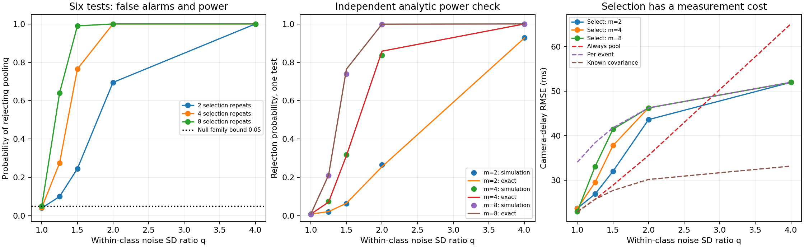

# Held-out covariance checks for optical camera timing

A **45–60 minute learning lab** connecting diffraction, pixel integration, subpixel vision and hypothesis testing. Can independent calibration repeats detect a bad pooling assumption before it damages a camera-delay measurement? This follows the pooled-covariance lesson with a materially new experiment: selection data, false-alarm control, exact detection power and independent final evaluation.

## Objectives, prerequisites and run

You will derive a pixel signal from a Gaussian pupil, recover optical time, construct six prespecified variance tests, quantify their detection power, and measure the cost of choosing a pooling policy. Prerequisites: Gaussian covariance, least squares, introductory Fourier optics and Python. Read the [pooling lesson](https://github.com/ahmetalpkilic/pooled-clock-covariance-learning-lab) first if covariance scatter is unfamiliar.

```sh
git clone https://github.com/ahmetalpkilic/held-out-covariance-validation-learning-lab.git
cd held-out-covariance-validation-learning-lab
sh run_demo.sh
```

Python 3.9–3.12 and a POSIX shell are required. The runner creates `.venv`, installs pinned dependencies, runs all 12 tests and generates `outputs/results.json` and `outputs/experiment.png`. Initial installation needs internet. Thereafter `.venv/bin/python lab.py` runs offline with synthetic data. Reference outputs are in `examples/`. Fixed seeds reproduce results in the pinned environment; final digits may vary across platforms.

Suggested pacing: 10 minutes physical model, 10 minutes F-test derivation, 10 minutes demo/plots, 10 minutes data separation, 5–20 minutes exercises.

| Area | Explicit model | Connection |
|---|---|---|
| Optics | 550 nm Gaussian pupil and Fourier diffraction | Sets the camera PSF width |
| Camera | 16 mm focal length, 4 µm pixel integration, 2 ADU read noise | Converts irradiance into sampled noisy data |
| Vision/metrology | Subpixel spot fit and known motion trajectory | Converts position to exposure time and clock delay |
| Mathematics | Gaussian scatter, F ratios, Bonferroni control and profiled regression | Selects calibration weights and validates measurement consequences |

## Physical model and conventions


The pupil amplitude is `exp(-(rho_x²+rho_y²)/a²)`, with amplitude radius `a=1000 µm`, wavelength `lambda=0.550 µm`, and focal length `f=16000 µm`. This is an **untruncated Gaussian pupil**, not a uniform circular aperture or an f-number model. Scalar paraxial monochromatic Fourier optics, an aberration-free isolated point and instantaneous exposure are assumed.

The Fourier amplitude is proportional to `exp(-(pi*a*x/(lambda*f))²)`. Squaring gives intensity SD `lambda*f/(2*pi*a)`. At pixel pitch `p=4 µm`,

```text
sigma_px = lambda*f/(2*pi*a*p) = 0.350140875 px
mu_j(u) = B + F [Phi((j+0.5-u)/sigma) - Phi((j-0.5-u)/sigma)]
```

`Phi` is the standard-normal CDF; `F=10000 ADU`, `B=20 ADU`. The camera has square pixels, no distortion/skew, principal point `(0,0)` and `K=diag(4000,4000,1)` in pixels. We simulate the horizontal marginal of a separable 2-D PSF. Signed ROI pixel centers are `j=-16,...,+16`, increasing to the right; each integrates `[j-0.5,j+0.5]`. These are not top-left array coordinates.

Each marginal sample receives independent Gaussian read noise of SD 2 ADU. There is no shot noise, saturation, quantization, or photometry fitting; flux, background and optical width are known. Least squares fits `u` using the analytic pixel-integral derivative. This high-SNR toy model isolates clock uncertainty, not a full camera noise budget.

The independently known image trajectory is `u(r)=u0+v*r`, `u0=0.23 px`, `v=0.8 px/reference second`. Clocks obey `r=alpha*t+beta`: true `alpha=1.002 reference s/master s`, `beta=0.030 reference s`. A frame tagged `T=2.0 master s` was exposed at `T+delta`, with true delay `delta=0.040 master s`.

Forty synchronization events span `[-1,+1] master s`. The true event times are **withheld from the estimator**. Even events have timestamp SDs `(0.030,0.020) s`, correlation 0.5. Odd events have SDs `(0.240,0.020*sqrt(8)) s`, correlation 0.2. The base class heterogeneity is fixed at `h=8`. Covariances have units s². Calibration is extrapolated to the frame time beyond the sync interval.

The new sensitivity factor `q=1,1.25,1.5,2,4` multiplies BOTH timestamp standard deviations for half the events **within each class**. Correlations stay fixed; thus `C_i(q)=s_i² C_class`, where `s_i=q` if `floor(i/2)` is odd and 1 otherwise. Classes are known from the experimental design (`i mod 2`), not inferred from evaluation residuals. At q=1 pooling is correctly specified; at q>1 the two labels hide four actual noise populations. Training and evaluation have the same per-event covariance: this is class mismatch, not temporal distribution shift.

## The new experiment: test before pooling

Each quality class has two **prespecified acquisition conditions**, `h=floor(i/2) mod 2`, with 10 events per condition. The conditions are observable design labels; the noise ratio q is withheld from the estimator. This is a targeted test of a suspected condition effect, not discovery of arbitrary unknown subgroups. q ranges over 1, 1.25, 1.5, 2 and 4.

Each of 400 outer trials uses four independent random streams:

1. One noisy camera spot image for the optical center.
2. Forty independent single timestamp pairs for the final clock fit.
3. Four training repeats per event (160 pairs) to estimate per-event and pooled covariance.
4. An additional m=2,4,8 held-out selection repeats per event (80,160,320 pairs) to test the pooling assumption.

The held-out repeats are excluded from covariance estimation and the final clock fit. Both selection and training are redrawn in every trial. Repeat means are never final synchronization observations. The same image/evaluation/training draws pair all policies; nested selection budgets and common standard normals pair sensitivity cases. This reduces comparison noise but makes points on the curves dependent. Budgets are separate scenarios, **not sequential looks on a single test**.

### Derivation: six projected-variance tests

For each event, subtract its own repeat mean, `e_ik=w_ik-wbar_i`. For one class g, condition h and fixed projection vector a, define

```text
s²_gh(a) = sum_{i in (g,h), k} (a^T e_ik)² / nu
nu = 10*(m-1)
a in {(1,0), (0,1), (1,1)}.
```

Each event consumes one fitted mean per projection: nu is NOT `10*m-1`. Under independent Gaussian repeats and equal covariance within a condition, `nu*s²_gh/(a^T C_gh a)` is chi-square with nu degrees of freedom. The two conditions contain disjoint events, so their scatter is independent. Under the shared-covariance null,

```text
R_g(a) = s²_g1(a) / s²_g0(a) ~ F(nu,nu)
p_g(a) = min(1, 2*min(F_CDF(R), F_SF(R))).
```

There are two classes times three projections = six tests. Reject pooling if ANY p-value is less than `alpha/6`, with family alpha=0.05. By the union bound, the chance of at least one false rejection is at most alpha when all nulls hold. Tests share data and are correlated; no test-independence assumption is needed. The bound need not be tight. See the primary [SciPy F-distribution definition](https://docs.scipy.org/doc/scipy/reference/generated/scipy.stats.f.html).

The three projections check both diagonal variances and, through `Var(x+y)=Var(x)+Var(y)+2Cov(x,y)`, covariance. Clock coordinates are both numerical seconds in their declared clock units, so the sum is defined; its sensitivity depends on that fixed scaling. If those three population variances match between conditions, their 2x2 covariance matrices match. Finite-sample non-rejection, however, **does not establish equality**, and these tests cannot rule out arbitrary event-specific heterogeneity within each condition.

### Exact power under the controlled alternative

The controlled mismatch multiplies both SDs in condition 1 by q, preserving correlation, so `R=q²*F(nu,nu)`. For a single test, with `l=F_inverse(alpha/12)` and `u=F_inverse(1-alpha/12)`,

```text
power_one(q,m) = F_CDF(l/q²) + F_SF(u/q²).
```

At q=1, this equals alpha/6. The plotted analytic line is **one test's power**, not the six-test rejection probability. With this common scale alternative, family power lies between single-test power and `min(1,6*power_one)`; actual family power is measured by simulation. False-alarm and power estimates have binomial Monte Carlo SE `sqrt(p_hat*(1-p_hat)/400)`; zero reported SE at an empirical rate of 0 or 1 is not proof of certainty.

### Policy and independent measurement

If any test rejects, use per-event covariance estimates; otherwise pool the training scatter within each original quality class. The global fallback is deliberately simple. The validation samples only select the policy; they do not supply its fitted covariance. For four training repeats,

```text
S_i = sum_k (w_ik-wbar_i)(w_ik-wbar_i)^T / 3
S_g = mean_{i in g} S_i       # 20 events, 60 scatter degrees of freedom
```

Do not divide these covariance estimates by repeat count: they weight single evaluation timestamps, not means. The comparisons are known true covariance (a simulation-only oracle), always pool, always per-event, and the selected policy. All policies pay the same training cost; selection requires the **additional** indicated repeat budget. This is not an equal-total-budget efficiency claim. Rejection can sacrifice useful pooling under the null; weak differences may pass undetected. A test threshold is not optimized for delay RMSE, so selection need not dominate both fixed policies.

### From covariance to optical delay


Treat `S_i` as a plug-in covariance, temporarily fixed during each fit. With latent true time `tau_i`, minimize

```text
Q = sum_i [z_i-(tau_i,alpha*tau_i+beta)]^T S_i^-1
          [z_i-(tau_i,alpha*tau_i+beta)]
```

For `d=(1,alpha)`, differentiation gives

```text
tau_i* = d^T S_i^-1 (x_i,y_i-beta) / (d^T S_i^-1 d).
V_i(alpha) = alpha²*S_i,xx - 2*alpha*S_i,xy + S_i,yy
Q_profile = sum_i (y_i-alpha*x_i-beta)²/V_i(alpha)
beta*(alpha) = sum_i [(y_i-alpha*x_i)/V_i] / sum_i [1/V_i].
```

Search numerically over `alpha in [0.5,1.5]`. The implementation checks a 65-point grid, refines bracketed minima and rejects boundary/flat fits. This is not a global-optimum guarantee for arbitrary data. Independent full latent-event optimization validates the implemented objective. There is no `log V_i` term: this profiles fixed latent times; it does not marginalize random times. With estimated covariance, this is a **plug-in procedure**, not the full likelihood jointly accounting for covariance uncertainty. We make no confidence-interval or coverage claim.

Finally,

```text
r_hat = (u_hat-u0)/v
 delta_hat = (r_hat-beta_hat)/alpha_hat - T
 d(delta) ≈ du/(v*alpha) - d(beta)/alpha - (T+delta)*d(alpha)/alpha.
```

Thus precise optical localization can coexist with poor delay precision when calibration weights are uncertain and rate errors are extrapolated.

Here `S_i` means either the per-event estimate or the class estimate assigned back to event i. The known-covariance oracle uses `C_i` instead.

## Expected results

For m=4 additional selection repeats/event (160 extra pairs):

| SD ratio q | Family rejection | Always pool RMSE (ms) | Per-event RMSE (ms) | Selected RMSE (ms) |
|---:|---:|---:|---:|---:|
| 1 | 4.25% | 22.866 | 34.051 | 23.633 |
| 1.25 | 27.50% | 25.753 | 38.434 | 29.559 |
| 1.5 | 76.50% | 28.873 | 41.767 | 37.779 |
| 2 | 100.00% | 35.573 | 46.234 | 46.234 |
| 4 | 100.00% | 65.101 | 51.965 | 51.965 |

At q=1, family false alarms are 4.0%, 4.25% and 5.0% for m=2,4,8. At q=1.5, detection rises from 24.5% to 76.5% to 99.0%. At q=4, all 400 trials reject for every budget. Optical center SD is 0.0002550 px. All fits succeeded.

**More detection is not automatically better metrology.** At q=1.5, increasing selection repeats from 2 to 8 raises selected delay RMSE from 31.991 to 41.428 ms: per-event covariance estimates are too noisy to justify abandoning pooling for this modest mismatch. At q=4, selection improves RMSE from 65.101 ms (always pool) to 51.965 ms. A variance hypothesis test and a decision that minimizes measurement error answer different questions.

The middle panel compares one-test rejection frequency against exact power; agreement is subject to Monte Carlo error. JSON also records bias, sample SD, RMSE and mean-error MCSE. These quantify simulation sampling, not device accuracy.



## Code and validation guide

- `optics.py`: pupil-derived width, exact pixel integral, analytic derivative, bounded spot fit.
- `clock_model.py`: eliminate latent event times and optimize rate/offset; convert optical center to delay.
- `pooling.py`: attributed predecessor covariance/scatter helpers.
- `lab.py::validate_classes`: remove event means, project residuals, form F ratios and apply six-test correction.
- `lab.py::marginal_power`: independent distribution-based prediction.
- `lab.py::experiment`: four independent streams and common evaluation data across policies.

Twelve tests include independent pupil FFT, pixel quadrature/derivative, noiseless delay, generalized-eigenvalue and full latent-event fit checks, event-mean invariance, NumPy covariance versus projected scatter, unit scaling, 200,000 independent chi-square ratios, 1,800 raw-repeat familywise trials, and an independent-seed optical-delay selection experiment. Invalid shapes, zero scatter, singular clock covariance and boundary fits fail explicitly. The demo stops on any fit failure rather than silently reporting conditional-on-success precision. This is numerical validation under stated assumptions, not a hardware calibration.

## Exercises

1. Derive nu for unequal repeat counts within a condition. Extend both F degrees of freedom and scatter normalization; test against independently simulated chi-square ratios.
2. Test only x and y while changing covariance correlation but keeping both marginal variances fixed. Add x+y back and measure the extra detection power.
3. Replace the global fallback with separate class decisions. Keep the six-test correction and evaluate delay using a fresh seed; count repeat costs.
4. Compare policies at equal TOTAL calibration budget by allocating some of 160 pairs to selection and the remainder to training. Predict the small-budget loss before running.
5. Randomly shuffle the hidden high-noise membership within each condition. Explain why this targeted class check can miss heterogeneity; propose a prespecified alternative diagnostic without inspecting evaluation outcomes.

## Limits and next lesson

The F law requires independent Gaussian errors and shared covariance within each tested condition. Heavy tails, drift, adaptively chosen groups or repeated testing invalidate the stated false-alarm guarantee. Known labels, optics, photometry, trajectory, affine clocks and reproducible fixed-event calibration repeats are assumed. There is no shot noise, finite exposure, aberration, saturation or real sensor data. Non-rejection is not certification, and plug-in covariance selection does not establish confidence-interval coverage. **Synthetic repeatability and numerical recovery are not instrument accuracy or traceability.**

Next focused lesson: replace rejection-based pooling with partial pooling tuned on an independent calibration split, comparing equal total repeat budgets and measuring downstream delay risk on fresh evaluation data.

## Attribution and source review

New validation/selection code and synthetic outputs are MIT, copyright 2026 ahmetalpkilic. `optics.py`, `clock_model.py`, `test_clock_model.py`, covariance helpers in `pooling.py`, pins and runner come from the [MIT pooled-covariance predecessor at 806f76c](https://github.com/ahmetalpkilic/pooled-clock-covariance-learning-lab/tree/806f76c4c8fe3d0342f2a7d8fc4fc21bf5269168). Physical-model and clock-profile explanations are adapted from that README. The predecessor and its estimated-covariance predecessor licenses are preserved.

Current public prysm (MIT, optics context; no copied code), SciPy and NumPy (BSD-3-Clause), Matplotlib (permissive license agreement) and the predecessor were reviewed. `sources.json` records exact source commits, API-reported commit/activity/push dates and pinned full license snapshots in `licenses/`. Some upstream API timestamps are later than the local retrieval clock; they are retained as reported, not interpreted as elapsed activity. Upstream review revisions differ from runtime versions pinned in `requirements.txt`. No upstream main-branch code is executed and installed distributions retain their third-party notices.
